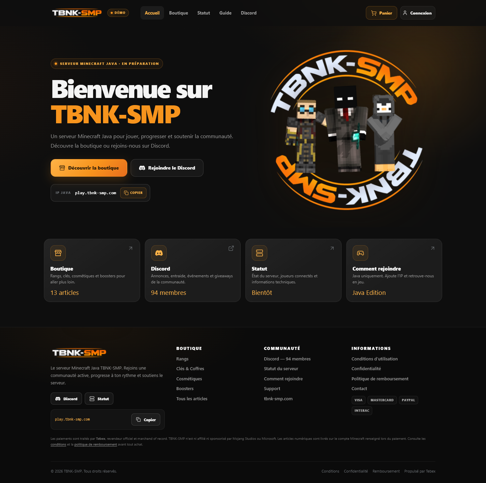
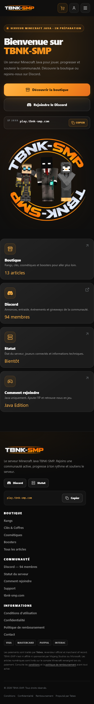
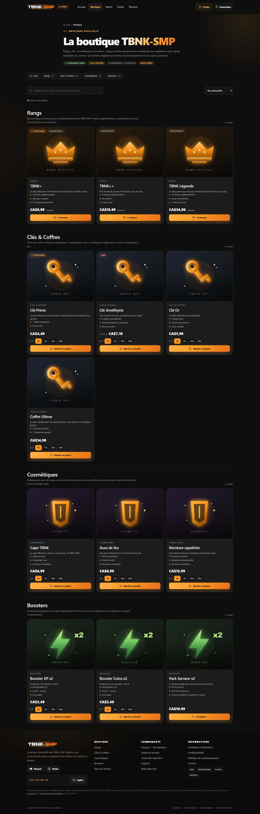
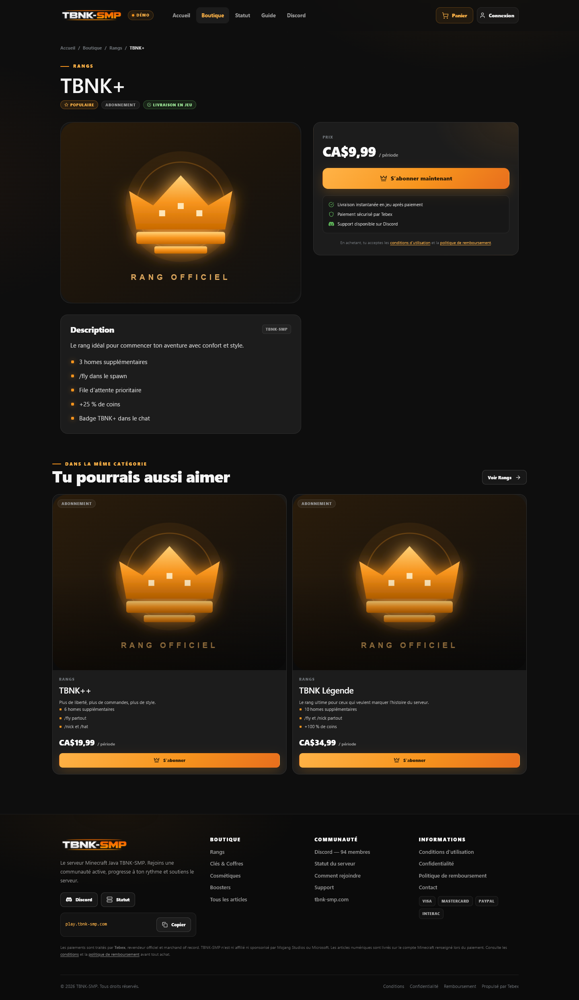
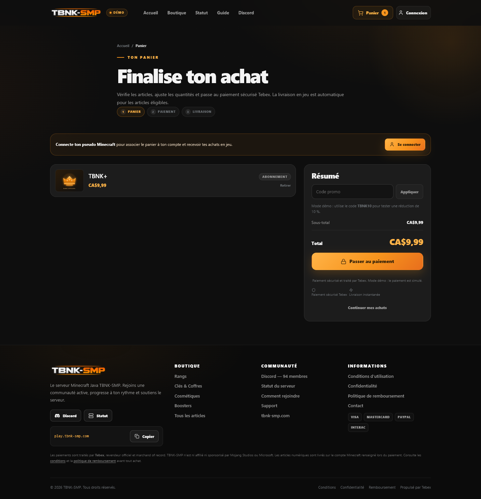
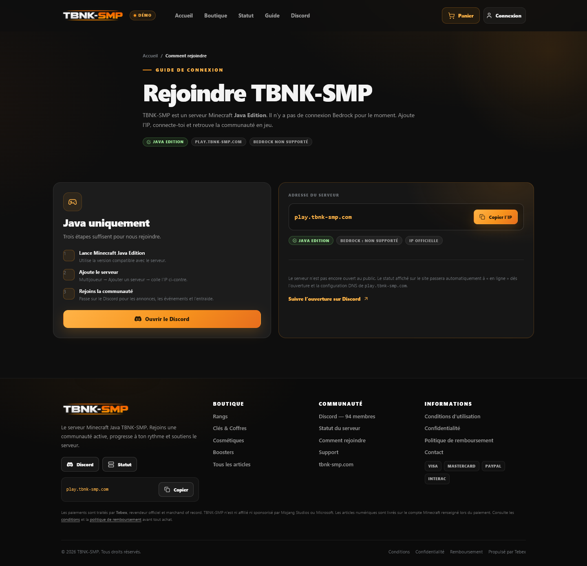
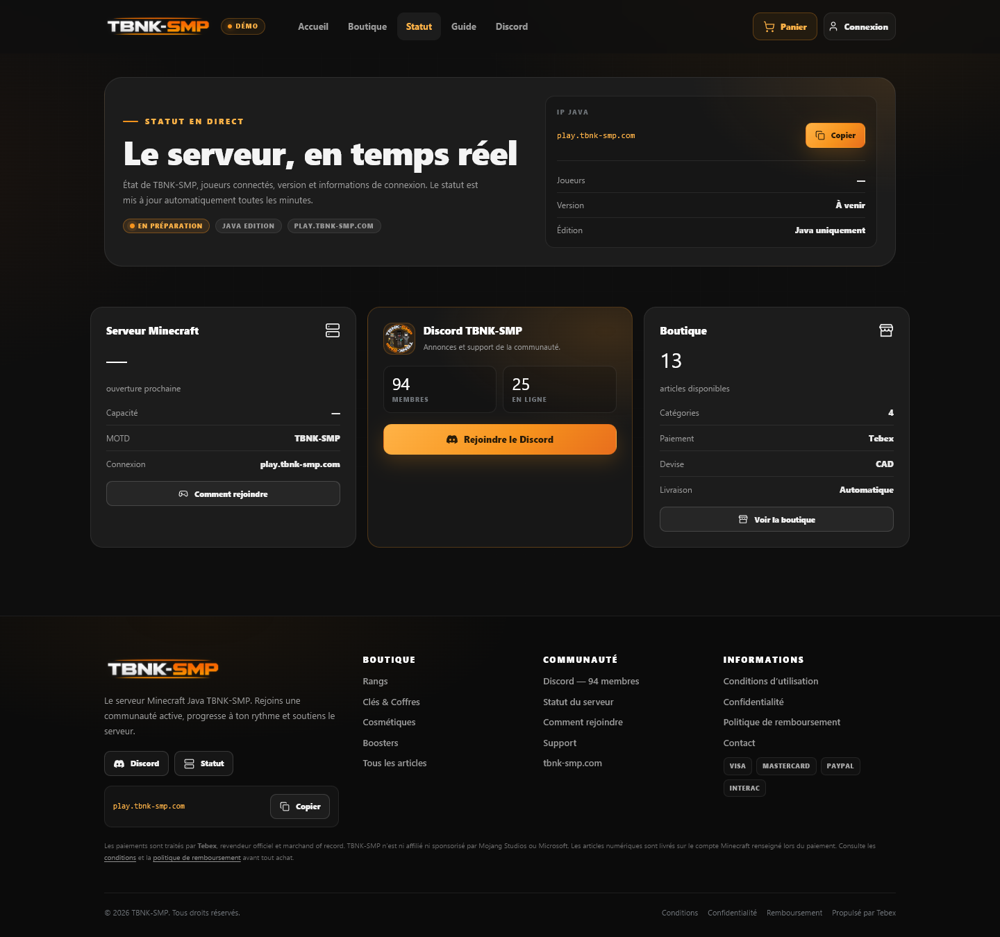

# TBNK-SMP — Boutique officielle

Site vitrine et boutique du serveur Minecraft Java **TBNK-SMP**, construit avec **Next.js 16**, **React 19**, **TypeScript** et l’**API Tebex Headless**.

> Ce projet n’est **pas** un thème Twig hébergé par Tebex. C’est un site autonome qui affiche le catalogue Tebex, gère le panier et ouvre le paiement sécurisé Tebex. C’est l’architecture utilisée par des sites comme BagelSMP, et elle fonctionne avec les nouvelles boutiques Tebex.

## Aperçu

Captures générées en **mode démo**, avec les données et les visuels de secours du projet.

| Accueil desktop | Accueil mobile |
|---|---|
|  |  |

| Boutique desktop | Fiche package |
|---|---|
|  |  |

| Panier | Guide de connexion |
|---|---|
|  |  |

| Statut |
|---|
|  |

## Fonctionnalités

- Page d’accueil “menu principal” simple : hero, bannière, IP Java copiable et 4 tuiles (Boutique, Discord, Statut, Guide).
- Page Guide dédiée pour rejoindre le serveur (Java uniquement).
- Boutique complète : catégories, recherche, tri, grille responsive, prix CAD, badges promo/populaire.
- Fiches packages : galerie, description riche, options/variables, quantité, abonnement ou achat unique.
- Panier : quantités, suppression, code promo, total, checkout Tebex.
- Connexion pseudo Minecraft Java, panier conservé en cookie httpOnly.
- Mode démo complet sans boutique Tebex, avec produits fictifs et panier simulé.
- Statut serveur via `mcsrvstat.us` et stats Discord via l’API publique d’invitation.
- Pages légales, 404, erreurs, sitemap, robots et image Open Graph.
- Design sombre/orange responsive, accessible et sans dépendance UI lourde.

## Stack

| Élément | Choix |
|---|---|
| Framework | Next.js 16 (App Router) |
| UI | React 19 + TypeScript |
| Styles | CSS modulaire + Tailwind CSS v4 |
| Paiement | Tebex Headless API + Tebex.js |
| Panier | Cookie httpOnly, sans base de données |
| Déploiement | Vercel ou serveur auto-hébergé (Node.js 20.9+) — voir docs/ovh-rise-s-setup.md |

## Démarrage rapide

```bash
npm install
npm run dev
```

Ouvre [http://localhost:3000](http://localhost:3000).

Sous Windows, si PowerShell bloque `npm.ps1` à cause de la politique d’exécution, utilise :

```powershell
& 'C:\Program Files\nodejs\npm.cmd' install
& 'C:\Program Files\nodejs\npm.cmd' run dev
```

### Mode démo

Le mode démo s’active automatiquement quand `TEBEX_PUBLIC_TOKEN` est vide **en développement ou en préproduction**. En production, le build/startup échoue si le token manque :

- catalogue fictif dans `data/mock.ts` ;
- panier simulé ;
- code promo de test : **TBNK10** (10 %) ;
- bouton de paiement qui ouvre une explication “mode démo” ;
- bandeau permanent et `noindex` en preview.

Aucun compte Tebex n’est nécessaire pour tester le design, le panier, la connexion et le parcours de commande en local.

## Configuration

Copie `.env.example` vers `.env.local` :

```bash
cp .env.example .env.local
```

```env
TEBEX_PUBLIC_TOKEN=""
NEXT_PUBLIC_SITE_URL="http://localhost:3000"
```

- `TEBEX_PUBLIC_TOKEN` : token **public** Tebex, disponible dans Creator Panel → Developers → API Keys. Il sert à lire le catalogue et à manipuler le panier. **N’utilise jamais le private key dans ce projet.**
- `NEXT_PUBLIC_SITE_URL` : URL publique du site, sans slash final. En production : `https://tbnk-smp.com`.
- `APP_ENV` : `development`, `preview` ou `production`. Sur Vercel, `VERCEL_ENV` est utilisé si `APP_ENV` est absent.
- `COOKIE_SECRET` : secret de signature des cookies, **obligatoire en production** (32 caractères minimum). Génère-le avec `openssl rand -base64 48`.
- `NEXT_PUBLIC_SUPPORT_EMAIL`, `NEXT_PUBLIC_PRIVACY_EMAIL`, `NEXT_PUBLIC_PRIVACY_OFFICER` : contacts **obligatoires en production** pour la Loi 25. `NEXT_PUBLIC_PRIVACY_OFFICER` attend le **titre/fonction** du responsable (le nom personnel n'est pas requis).
- `NEXT_PUBLIC_LEGAL_*` : **facultatif** — identité d'entreprise (nom, adresse, téléphone) à afficher si TBNK-SMP est le vendeur. Par défaut, le vendeur des produits est **Tebex** (marchand of record) : ces champs ne sont pas nécessaires.
- `NEXT_PUBLIC_PRICES_INCLUDE_TAXES` : `true` si les prix Tebex incluent déjà les taxes, sinon `false`.

### Environnements et mode démo

| Environnement | Détection | Token Tebex | URL | Indexation | Paiement |
|---|---|---|---|---|---|
| Développement | `APP_ENV=development` | optionnel ; absent → démo | `http://localhost:3000` | non | simulé |
| Préproduction | `APP_ENV=preview` ou `VERCEL_ENV=preview` | absent → démo ; sinon token de **test** | URL de preview | **noindex + protection Vercel** | simulé ou test |
| Production | `APP_ENV=production` ou `VERCEL_ENV=production` | **obligatoire** | HTTPS public | indexation | réel |

Règles importantes :

- En production, le build/startup **échoue** si `TEBEX_PUBLIC_TOKEN`, `NEXT_PUBLIC_SITE_URL`, `COOKIE_SECRET` ou les contacts de confidentialité obligatoires manquent.
- `ALLOW_DEMO=true` est ignoré/interdit en production.
- En preview Vercel sans token, la démo est active automatiquement ; le site est `noindex` et un bandeau « Démo/Préproduction » est affiché.
- Ne jamais utiliser le token Tebex de production dans une preview : utilise une boutique/token de test séparé.
- En développement, le bouton de paiement ouvre le modal de démonstration ; aucun paiement réel n’est effectué.

### Conformité Québec (Loi 25, LPC, langue française)

Avant une ouverture publique au Québec :

- désigner un **responsable de la protection des renseignements personnels** et publier son **titre et ses coordonnées** (art. 3.1 P-39.1 : le nom personnel n'est pas exigé) ;
- compléter la politique de confidentialité (finalités, droits, témoins, tiers, transferts hors Québec, incidents, mineurs de moins de 14 ans, plainte CAI) ;
- recueillir un **consentement explicite** pour les témoins non nécessaires (YouTube, avatars mc-heads) et permettre le retrait à tout moment ;
- afficher clairement que **Tebex est le vendeur et marchand of record** (le contrat de vente est conclu exclusivement avec Tebex) et fournir ses conditions/coordonnées avant l’achat ; si TBNK-SMP est le vendeur, renseigner `NEXT_PUBLIC_LEGAL_*` ;
- afficher clairement les taxes et le total avant paiement ;
- vérifier que Tebex envoie un **reçu/contrat en français** dans les 15 jours et que le checkout est en français ;
- faire valider les conditions et la politique de remboursement par un juriste québécois ;
- conserver une politique interne de gouvernance, un registre des incidents et une EFVP pour les transferts hors Québec.

Le site présente Tebex comme vendeur des produits et TBNK-SMP comme exploitant du site et du serveur. Les champs `NEXT_PUBLIC_LEGAL_*` ne sont donc pas requis par défaut ; ils restent disponibles si l’exploitant doit être identifié comme commerçant.

Le site affiche un avertissement en développement/préproduction si les contacts de confidentialité sont incomplets. Un build de production échoue tant qu’ils ne sont pas renseignés.

Après avoir ajouté le token, redémarre le serveur. Le badge “Démo” disparaît et les produits viennent de ta boutique Tebex.

## Créer et connecter la boutique Tebex

1. **Créer un compte Tebex** et une boutique.
2. Compléter la revue de boutique Tebex si nécessaire.
3. Dans Tebex, configurer :
   - le nom **TBNK-SMP** ;
   - le logo et le favicon ;
   - la devise **CAD** ;
   - la langue française si disponible.
4. Créer les catégories et les packages :
   - type `single` (achat unique) ou `subscription` (abonnement) ;
   - prix, description riche, image ;
   - slug lisible (les URLs du site utilisent le slug Tebex) ;
   - livraison Minecraft configurée.
5. Configurer les moyens de paiement et la livraison en jeu (plugin/RCON Tebex).
6. Récupérer le **public token** dans Creator Panel → Developers → API Keys.
7. Ajouter le token dans `.env.local` ou dans les variables d’environnement de l’hébergeur (Vercel ou OVHcloud).
8. Tester un achat réel avec un petit package avant l’ouverture publique.

### Packages populaires

Les badges “Populaire” sont définis dans `lib/site.ts` :

```ts
popularPackages: ["tbnk-plus", "cle-prime"]
```

Remplace ces slugs par ceux de tes vrais packages Tebex.

### Abonnements

Les packages de type `subscription` affichent “S’abonner”. Tebex gère la récurrence, la période et les paiements associés. Le site ne stocke aucune information de carte bancaire.

## Déploiement sur Vercel

1. Pousse le projet sur GitHub.
2. Sur Vercel, importe le dépôt.
3. Vérifie que le framework détecté est **Next.js**.
4. Ajoute les variables d’environnement :
   - `TEBEX_PUBLIC_TOKEN` ;
   - `NEXT_PUBLIC_SITE_URL=https://tbnk-smp.com`.
5. Déploie.
6. Ajoute le domaine `tbnk-smp.com` et `www.tbnk-smp.com` dans Vercel, puis configure les enregistrements DNS indiqués par Vercel.
7. Garde `play.tbnk-smp.com` **pour le serveur Minecraft**, pas pour le site.
8. Optionnel : `store.tbnk-smp.com` peut pointer vers la page Tebex hébergée, mais ce n’est pas nécessaire au fonctionnement du site.

### Domaine et DNS

| Sous-domaine | Usage |
|---|---|
| `tbnk-smp.com` | Site Next.js (Vercel ou OVHcloud) |
| `www.tbnk-smp.com` | Redirection vers l’apex |
| `play.tbnk-smp.com` | Serveur Minecraft Java (DNS serveur, plus tard) |
| `store.tbnk-smp.com` | Optionnel : page Tebex hébergée |

Le statut du serveur restera sur **“En préparation”** tant que `play.tbnk-smp.com` n’a pas d’enregistrement DNS public et que le serveur n’est pas en ligne. Le site fonctionne quand même.

### Hébergement auto-hébergé (OVHcloud)

Pour héberger le site et le serveur Minecraft sur un serveur dédié OVHcloud Rise-S, consulte le guide complet : [docs/ovh-rise-s-setup.md](docs/ovh-rise-s-setup.md).

### Build local

```bash
npm run build
npm run start
```

`npm run build` sans variables compile en mode développement. En revanche, `npm run start` sans `APP_ENV`/`VERCEL_ENV` est volontairement traité comme une **production** : il exige le token, l’URL publique, `COOKIE_SECRET` et les mentions légales. Pour tester localement le build en mode démo, utilise :

```powershell
$env:APP_ENV='development'
& 'C:\Program Files\nodejs\npm.cmd' run start
```

ou plus simplement `npm run dev` pour le développement quotidien.

Le build utilise `next/font/google` pour Montserrat et Pixelify Sans : une connexion réseau est nécessaire au build pour télécharger les polices. Les polices sont ensuite servies par le site.

## Images et branding

Le site utilise tes fichiers :

- `public/images/logo.png` : logo horizontal, recadré et optimisé en **700×162** ;
- `public/images/banner.png` : bannière, optimisée en **1024×1024** ;
- `public/images/package-placeholder.svg` ;
- `public/images/packages/*.svg` : visuels de démonstration ;
- `app/icon.svg` : favicon.

Les anciens SVG (`logo-tbnk.svg`, `banner-tbnk.svg`) restent disponibles comme secours. `lib/site.ts` pointe déjà vers les PNG :

```ts
logo: "/images/logo.png",
banner: "/images/banner.png",
```

Pour changer de visuel, écrase simplement ces fichiers en conservant les noms, ou modifie `lib/site.ts`. Les images sont volontairement redimensionnées pour le web ; si tu as besoin de la pleine résolution, utilise un fichier source séparé et adapte le chemin.

Pour les images de packages, upload-les dans Tebex : elles seront servies par le CDN Tebex. Le logo de la boutique peut aussi être configuré dans Tebex : le site utilise `store.logo` quand il est disponible.

## Personnalisation

### Identité et communauté

`lib/site.ts` centralise :

- nom, description, domaine, URL ;
- IP Java (`play.tbnk-smp.com`) ;
- lien Discord ;
- devise CAD et locale `fr-CA` ;
- couleurs principales ;
- packages populaires.

### Couleurs et styles

Les variables sont dans `styles/base.css` :

```css
:root {
  --bg: #0e0e0e;
  --card: #1c1c1c;
  --accent: #f7941d;
  --accent-deep: #e86e1d;
  --text: #f4f4f4;
  --muted: #9a9a9a;
}
```

Les composants sont dans `styles/layout.css`, `styles/components.css`, `styles/pages.css` et `styles/responsive.css`.

### Données de démonstration

- `data/mock.ts` assemble les catégories et packages fictifs.
- `data/seeds/ranks.ts`, `keys.ts`, `cosmetics.ts`, `boosters.ts` contiennent les données par catégorie.

Ces fichiers ne sont utilisés que si `TEBEX_PUBLIC_TOKEN` est absent.

### Textes légaux

Les pages `/legal/terms`, `/legal/privacy`, `/legal/refund` et `/legal/contact` sont dans `lib/legal/`.

> Les textes fournis sont des **modèles de base**. Fais-les vérifier par un professionnel et adapte-les à ta situation (entreprise, juridiction, politique de remboursement, etc.). Tebex est le marchand of record pour les paiements.

### Polices

Les polices sont chargées dans `app/layout.tsx` avec `next/font/google` :

- **Montserrat** pour le texte et les titres ;
- **Pixelify Sans** pour les noms d’items et les badges.

Tu peux remplacer ces polices ou auto-héberger les fichiers si tu préfères éviter Google Fonts.

## Architecture du projet

```text
app/
├─ layout.tsx              # layout global, polices, métadonnées
├─ page.tsx                # accueil
├─ store/page.tsx          # toutes les catégories
├─ store/[slug]/page.tsx   # catégorie
├─ package/[slug]/page.tsx # fiche package
├─ cart/page.tsx           # panier
├─ login/page.tsx          # connexion pseudo
├─ status/page.tsx         # statut serveur/Discord
├─ guide/page.tsx          # comment rejoindre le serveur
├─ legal/[slug]/page.tsx   # pages légales
├─ sitemap.ts, robots.ts, opengraph-image.tsx
components/
├─ layout/                 # header, menu mobile, footer
├─ home/                   # hero, catégories, communauté
├─ store/                  # catalogue, carte produit
├─ package/                # galerie, panier d’achat
├─ cart/                   # ligne panier, coupon, checkout
├─ login/                  # formulaire de connexion
└─ ui/                     # icônes, toasts, copy, avatar
lib/
├─ tebex/                  # client API, mapper, types, storefront
├─ basket/                 # cookies, session, actions serveur
├─ community/              # Discord + statut Minecraft
├─ legal/                  # contenu des pages légales
├─ format.ts, site.ts
data/
├─ mock.ts, seeds/         # catalogue de démonstration
styles/
├─ base.css, layout.css, components.css, pages.css, responsive.css
scripts/
├─ e2e.mjs                 # parcours panier/coupon/checkout
├─ screenshots.mjs         # captures Edge desktop/mobile
└─ validate.mjs            # vérification du projet
```

### Flux panier

1. L’utilisateur ajoute un package depuis une carte ou une fiche.
2. En mode réel, le pseudo Minecraft est requis avant l’ajout. S’il manque, l’action stocke l’ajout en attente et redirige vers `/login`.
3. Le panier Tebex est créé côté serveur avec `username`, puis stocké dans un cookie httpOnly.
4. Les quantités et suppressions passent par des Server Actions.
5. Le code promo est appliqué via l’API Headless.
6. Le checkout utilise **Tebex.js**. En cas d’échec, le site redirige vers `basket.links.checkout`.

### API Tebex

Le client est dans `lib/tebex/client.ts`. Il gère notamment :

- les lectures de catalogue avec cache (`revalidate: 300`) ;
- les appels panier sans cache ;
- les endpoints d’ajout/suppression/quantité à la racine `/baskets/...` (particularité confirmée de l’API Tebex) ;
- les codes promo et cartes cadeaux ;
- les erreurs et les statuts “not found” variables selon les endpoints.

Le **private key** Tebex n’est jamais utilisé. Seul le public token, prévu pour le storefront, est nécessaire.

## Scripts et validation

| Commande | Rôle |
|---|---|
| `npm run dev` | Serveur de développement |
| `npm run build` | Build de production |
| `npm run start` | Serveur de production |
| `npm run typecheck` | Vérification TypeScript |
| `npm run test:e2e` | Parcours panier/coupon/checkout en mode démo |
| `npm run test:security` | Vérifie les 404, les redirections `next`/pending et le vidage du panier après checkout |
| `npm run screenshots` | Captures desktop/mobile avec Edge |
| `npm run validate` | Vérifie les fichiers, assets et secrets |

Les captures sont écrites dans `preview-output/` (ignoré par Git). Le script de captures utilise Edge :

```powershell
node scripts/screenshots.mjs
```

Si Edge n’est pas au chemin par défaut, définis `EDGE_PATH`.

### Ce que teste le parcours e2e

- ajout d’un package avec quantité 5 ;
- compteur du panier ;
- total CAD ;
- application du code promo **TBNK10** ;
- ouverture de la modale de checkout démo ;
- suppression de l’article et retour à l’état vide ;
- absence d’erreur console.

### Validation avant mise en ligne

1. `npm run typecheck`
2. `npm run build`
3. `npm run test:e2e`
4. `npm run test:security`
5. `npm run screenshots`
6. Vérifier les captures desktop et mobile.
7. Avec un token Tebex réel :
   - le catalogue se charge ;
   - l’ajout au panier fonctionne avec un pseudo Minecraft ;
   - le panier persiste ;
   - le checkout Tebex s’ouvre ;
   - un petit achat de test est livré en jeu.
7. Vérifier les pages légales et le footer Tebex.
8. Vérifier le domaine et le HTTPS sur Vercel ou OVHcloud.
## Sécurité

- Le **public token** Tebex est utilisé côté serveur. Le private key n’est jamais présent dans le code.
- Les cookies de panier et de pseudo sont `httpOnly`, `sameSite=lax`, `secure` en production, signés par HMAC et préfixés `__Host-` en production.
- Les Server Actions valident les quantités, les variables, les identifiants de package et les chemins de redirection. Le cookie `tbnk_pending_add` est signé et revalidé avant usage.
- Les descriptions Tebex sont nettoyées avec une allowlist (`sanitize-html`) avant rendu, et le JSON-LD est échappé.
- Les réponses d’erreur Tebex ne sont pas renvoyées telles quelles au client.
- Une CSP complète est configurée (scripts, styles, images, frames, connect, form-action, frame-ancestors), avec `X-Frame-Options`, `nosniff`, HSTS et `Referrer-Policy`.
- Tebex.js n’est chargé qu’au clic sur « Passer au paiement » ; YouTube et mc-heads sont soumis au consentement.
- Le rate limiting fourni est best-effort et local à l’instance ; pour un déploiement multi-instance, ajouter Vercel WAF ou Upstash. `TRUST_PROXY` doit être configuré en self-hosted.
- Les prix et la disponibilité sont lus depuis Tebex ; le site ne fait pas confiance à un prix envoyé par le client.
- Les textes légaux et la mention **Tebex merchant of record** sont inclus dans le footer. Ne les supprime pas sans raison légale.
- Les images de packages et les descriptions viennent de ton tableau de bord Tebex : garde ton compte Tebex sécurisé.

## Limites connues

- **Pas de thème Tebex hébergé** : ce projet est un site autonome. Tebex reste la caisse et le système de livraison.
- **Pas d’historique de commandes** : l’API publique utilisée ne l’expose pas. Cela nécessiterait l’API privée/Plugin API avec une clé secrète, volontairement exclue.
- **404 et streaming** : le `loading.tsx` global a été retiré pour conserver un vrai statut HTTP 404 sur les slugs inconnus (Next renvoie 200 si le streaming a déjà commencé).
- **Pas de multi-devise** : la devise suit celle de la boutique Tebex (CAD par défaut).
- **Pas de Bedrock** : le serveur est Java uniquement, conformément à la configuration actuelle.
- **Statut serveur** : dépend de `mcsrvstat.us` et de la disponibilité publique de `play.tbnk-smp.com`.
- **Stats Discord** : valeurs approximatives fournies par l’API d’invitation Discord ; un cache de 5 minutes est utilisé.
- **Images jointes** : les PNG fournis dans la conversation ne sont pas dans le dépôt ; les SVG de secours sont utilisés tant que tu ne les remplaces pas.
- **Paiement réel** : impossible à tester sans boutique Tebex et sans token. Le mode démo couvre l’UX, pas la transaction réelle.
- **Textes légaux** : modèles à faire valider par un professionnel.
- **Polices** : Google Fonts est utilisé au build ; si tu préfères zéro dépendance externe, auto-héberge les polices.

## Checklist de lancement

- [ ] `public/images/logo.png` et `public/images/banner.png` sont bien tes visuels définitifs.
- [ ] `lib/site.ts` mis à jour : IP, Discord, domaine, packages populaires.
- [ ] Boutique Tebex créée, catégories et packages publiés.
- [ ] Devise CAD configurée dans Tebex.
- [ ] Livraison Minecraft testée.
- [ ] `TEBEX_PUBLIC_TOKEN` ajouté chez l’hébergeur (Vercel ou OVHcloud).
- [ ] `NEXT_PUBLIC_SITE_URL=https://tbnk-smp.com`.
- [ ] Domaine et DNS configurés ; `play.tbnk-smp.com` réservé au serveur.
- [ ] Achat test effectué et livré.
- [ ] Pages légales relues.
- [ ] `npm run build`, `npm run test:e2e` et `npm run test:security` passent.
- [ ] Captures desktop/mobile vérifiées.

## Support

- Discord TBNK-SMP : [discord.gg/td98WkM7V5](https://discord.gg/td98WkM7V5)
- Tebex : [tebex.io](https://www.tebex.io)

## Crédits

Projet réalisé pour **TBNK-SMP**. Design original inspiré de l’univers Minecraft, sans copie d’assets BagelSMP, Mojang ou Tebex. Les polices Montserrat et Pixelify Sans sont distribuées via Google Fonts sous licence OFL. Les icônes SVG sont originales.

Ce dépôt n’est ni affilié ni sponsorisé par Mojang Studios, Microsoft ou Tebex.
